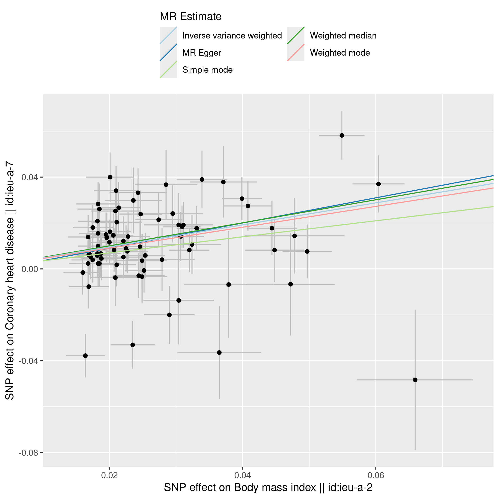
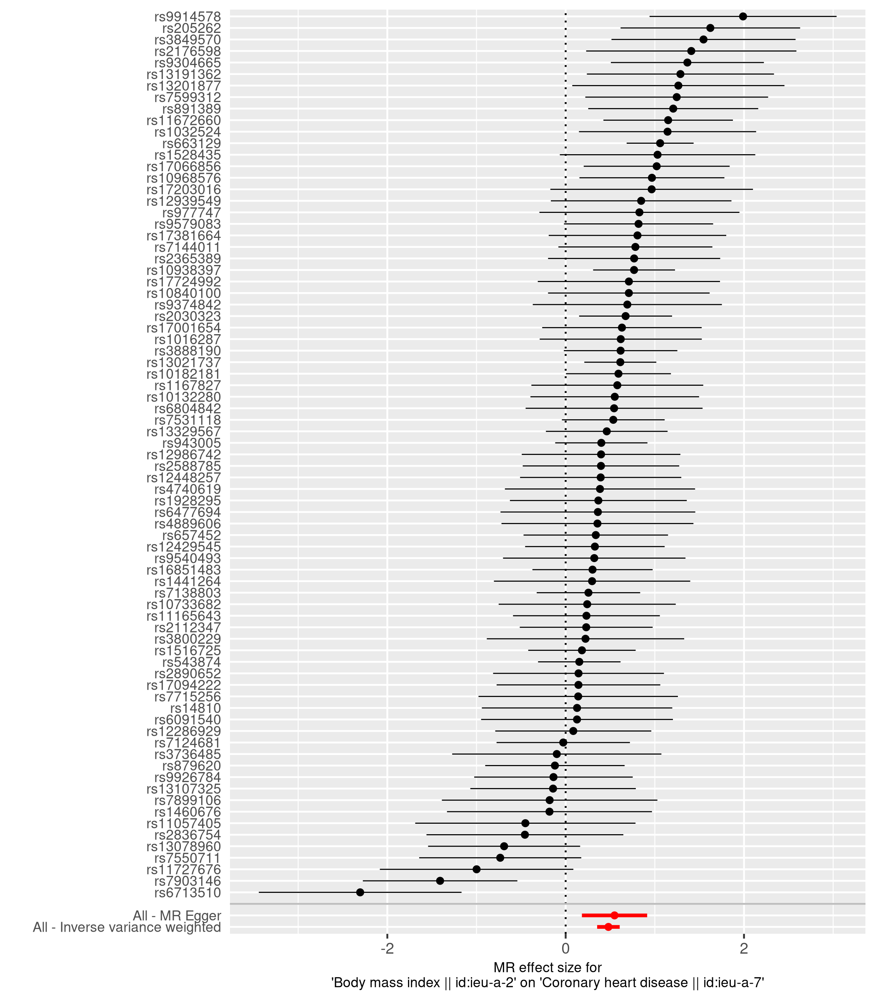
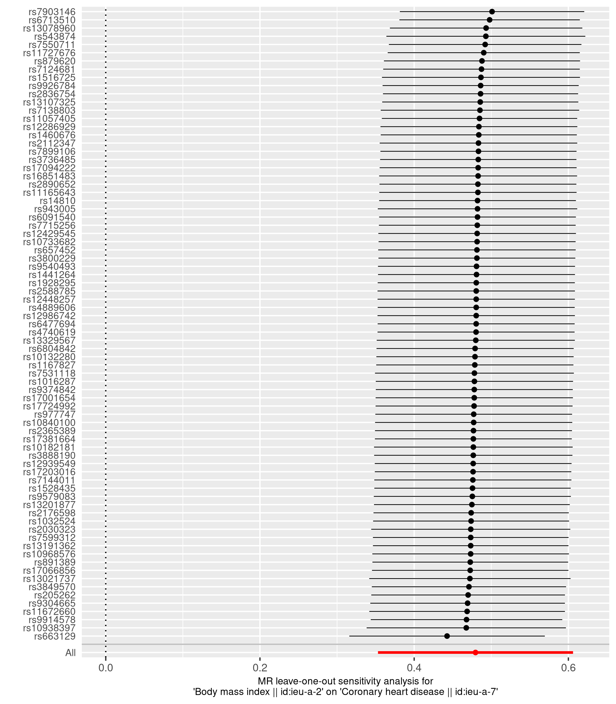

# Two-sample Mendelian randomization: BMI and coronary heart disease

A small, reproducible analysis testing whether genetically predicted body mass
index (BMI) is causally associated with coronary heart disease (CHD), using
two-sample Mendelian randomization (MR) with public GWAS summary statistics.

I built this as a learning project to get hands-on with the standard MR workflow
(instrument selection, harmonisation, multiple estimators, sensitivity analyses)
that underlies drug-target MR and other genetic epidemiology work.

## Question

Does higher BMI causally increase CHD risk, or is the observational association
explained by confounding or reverse causation?

## Data

Summary statistics retrieved through the OpenGWAS API:

| Role     | OpenGWAS ID | Trait |
|----------|-------------|-------|
| Exposure | `ieu-a-2`   | Body mass index (study and sample size: see `gwasinfo("ieu-a-2")`) |
| Outcome  | `ieu-a-7`   | Coronary heart disease (study and sample size: see `gwasinfo("ieu-a-7")`) |

## Methods

1. **Instruments:** genome-wide significant SNPs for BMI (p < 5e-8), LD-clumped
   to independent variants (`extract_instruments`, TwoSampleMR defaults).
2. **Outcome lookup:** the same SNPs extracted from the CHD GWAS
   (`extract_outcome_data`).
3. **Harmonisation:** effect alleles aligned across studies, palindromic SNPs
   handled (`harmonise_data`).
4. **Estimation:** inverse-variance weighted (IVW), MR-Egger, weighted median,
   simple and weighted mode.
5. **Sensitivity analyses:** Cochran's Q heterogeneity, MR-Egger intercept test
   for directional pleiotropy, leave-one-out and single-SNP analyses.

### MR assumptions

- **Relevance:** instruments are associated with BMI.
- **Independence:** instruments are not associated with confounders.
- **Exclusion restriction:** instruments affect CHD only through BMI.

Only relevance is directly testable; the sensitivity analyses probe violations
of the exclusion restriction (horizontal pleiotropy).

## Results

77 SNPs were used as instruments.

| Method | log OR | OR per 1-SD BMI (95% CI) | p |
|---|---|---|---|
| IVW | 0.480 | 1.62 (1.42-1.83) | 1.1e-13 |
| Weighted median | 0.502 | 1.65 (1.42-1.92) | 3.4e-11 |
| MR-Egger | 0.548 | 1.73 (1.20-2.49) | 0.004 |
| Weighted mode | 0.454 | 1.57 (1.17-2.12) | 0.004 |
| Simple mode | 0.349 | 1.42 | 0.034 |

- **Heterogeneity:** Cochran's Q = 144.1 (76 df, p = 4.0e-6), indicating
  between-SNP heterogeneity.
- **Directional pleiotropy:** MR-Egger intercept = -0.0019 (SE 0.0049,
  p = 0.70), with no evidence of directional pleiotropy (although Egger has
  limited power).

**Interpretation:** All five estimators point to a positive association between
genetically predicted BMI and CHD risk, with similar magnitudes (OR roughly
1.4-1.7 per SD of BMI). Agreement between methods that make different
assumptions about pleiotropy strengthens the case that the association is not
driven by a few invalid instruments. Significant heterogeneity suggests some
SNPs have additional pathways to CHD, so the estimate should be read as
consistent with, not proof of, a causal effect.





## Limitations

- Estimates reflect effects of **lifelong** genetic differences in BMI, not the
  effect of a later-life intervention.
- Assumes a linear exposure-outcome relationship.
- The source GWASs are largely of European ancestry, which limits
  generalisability.
- Summary statistics only: no individual-level data, so non-linearity and
  confounding structure cannot be examined directly.
- Significant heterogeneity means some instruments may be pleiotropic; I did not
  run outlier-removal methods (e.g. MR-PRESSO) or multivariable MR.
- This is a tutorial-scale analysis, not a publication-grade study.

## Reproducing the analysis

Requirements: R (>= 4.x), the `TwoSampleMR` package, and a free OpenGWAS account.

```r
install.packages("remotes")
remotes::install_github("MRCIEU/TwoSampleMR")
```

1. Generate a token at <https://api.opengwas.io/profile/>.
2. Add it to `~/.Renviron` as `OPENGWAS_JWT=<your token>` (no quotes or spaces)
   and restart R. **Never commit the token.**
3. Run `Rscript mr_bmi_chd.R`. Outputs go to `results/`.

## Repository structure

```
mr_bmi_chd.R     analysis script
results/         tables, figures, session info
README.md        this file
```

## References

- Hemani G, et al. The MR-Base platform supports systematic causal inference
  across the human phenome. *eLife* 2018.
- Davey Smith G, Hemani G. Mendelian randomization: genetic anchors for causal
  inference in epidemiological studies. *Hum Mol Genet* 2014.

## Author

Arif Mohammed M A
